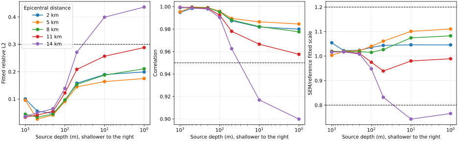

# 50×50×25大型半空间远场测试

## 震源埋深递减扫描（2026-10-08至09）

新增500、200、100、50、10 m五组Debug CUDA三方向全流程，复用下节同深度对照的
1000 m、1 m端点。每组保持50×50×25个1 km单元、N=4、1 Hz Ricker、均匀介质、
450步/150帧不变；SEM与Johnson参考源使用相同埋深，地表接收点仍为2/5/8/11/14 km。
各距离窗口分别为3.5/4.5/5.5/6.5/7.3 s，均早于镜像路径估算的最早PML返回。
指标合并三种力方向和三个位移分量，不是逐分量门限测试。

### 误差随埋深变化

表中为拟合相对L2（百分比），通过要求仍为corr≥0.95、scale∈[0.8,1.2]、拟合L2≤30%。

| 埋深 | 2 km | 5 km | 8 km | 11 km | 14 km |
|-----:|-----:|-----:|-----:|------:|------:|
| 1000 m | 10.02% | 9.55% | 4.45% | 3.37% | 3.62% |
| 500 m | 5.57% | 2.67% | 3.36% | 4.13% | 4.96% |
| 200 m | 4.73% | 4.15% | 4.50% | 5.49% | 6.44% |
| 100 m | 9.41% | 9.09% | 9.69% | 12.23% | 13.89% |
| 50 m | 15.80% | 14.47% | 15.34% | 20.83% | 27.11% |
| 10 m | 18.95% | 16.38% | 18.75% | 25.65% | 39.92% |
| 1 m | 19.89% | 17.50% | 21.05% | 28.82% | 43.62% |

完整corr、scale、拟合L2、窗口及数据来源见
[halfspace-source-depth.csv](data/halfspace-source-depth.csv)。1000 m和1 m为报告中六位小数
的历史端点，未在本次重算；其PML返回时间未填入CSV，避免伪造新的运行记录。

- 1000–50 m各距离全部通过；10 m、1 m均只有14 km未通过。
- 200 m以下，各距离拟合L2均随埋深减小而上升；14 km最明显：6.44%→13.89%→27.11%
  →39.92%→43.62%。在这套采样和门限下，14 km的通过/失败转换位于10–50 m之间，
  不是已经确定的物理临界深度。
- 1000→500→200 m并非所有距离都单调恶化：近处2 km先改善，5/8 km在500 m附近较好。
  因此不能将结论概括为任意埋深区间内“越浅越差”。
- 14 km的scale从500/200 m时的1.0174/1.0082降至100 m的0.9484、50 m的0.8322、
  10 m的0.7433；1 m为0.7659。幅度比例在10→1 m间并不单调，但波形残差继续增加。
- 对照确认误差与浅源条件相关，不能单凭此扫描判定SEM或参考解哪一方主导。
  参考解数值积分与时间采样收敛、分量及体波/面波窗口分解仍未验证。

### 完整性、耗时与数据位置

五组均完成三方向450步正演、三个tile后处理及五个位置的理论对比，15个保留tile的
所有浮点数据集检查无Inf/NaN。新增25个对比点中24个通过。注意现有`compare_grid.py`
退出码只判定11 km基准；本次逐点重新判定，不将脚本退出0误当成所有距离通过。

| 埋深 | C++预处理 | 全流程（含网格、对比和快照清理） |
|-----:|----------:|------------------------------:|
| 500 m | 12.9 s | 1782.0 s |
| 200 m | 13.4 s | 1820.9 s |
| 100 m | 13.7 s | 1769.1 s |
| 50 m | 13.9 s | 1772.8 s |
| 10 m | 13.8 s | 1789.3 s |

五组累计8934.1 s（约2小时29分钟）。最初一次启动被命令包装器默认30秒超时终止，
重新设置12小时超时后五组顺序完成；该失败启动不计入上述时间。
运行期间约每15分钟主动检查一次。每组约197 GiB快照在比较完成后清理，无法直接恢复；
本地`examples/halfspace-50x50x25/depth_sweep/depth_XXXXm/`保留日志、`metrics.csv`、
`config.h5`和三个tile，用于后续分量与参考解收敛研究。扫描结束时磁盘剩余569 GiB。

## 同深度震源与解析解对照（2026-10-08）

使用 `gf_preprocess run` 纯 C++ 预处理路径，分别令 SEM 源和 Johnson 解析源同为 1 m、
同为 1 km。两组均为同一均匀半空间、50×50×25个1 km单元、N=4、1 Hz Ricker、450步、
150帧、三方向正演；接收点为源沿x方向2/5/8/11/14 km处的地表点。C++预处理均约13秒。
每格为 `corr / scale / 拟合L2`，指标包含三种力方向及全部三个位移分量：

| 源深度 | 2 km | 5 km | 8 km | 11 km | 14 km |
|-------:|:-----|:-----|:-----|:------|:------|
| 1 m | 0.980023 / 1.045859 / 0.198884 | 0.984568 / 1.110630 / 0.175002 | 0.977593 / 1.082704 / 0.210505 | 0.957574 / 0.989301 / 0.288189 | 0.899865 / 0.765946 / 0.436169 |
| 1 km | 0.994963 / 1.054427 / 0.100242 | 0.995433 / 1.003104 / 0.095467 | 0.999008 / 1.019958 / 0.044529 | 0.999431 / 1.017489 / 0.033726 | 0.999345 / 1.016339 / 0.036175 |

- 1 m组在2–11 km均通过 `corr≥0.95`、`scale∈[0.8,1.2]`、拟合L2≤0.30门限；14 km未通过。
- 1 km组五个距离全部通过，最远14 km拟合L2为0.036175。
- 两组比较窗均早于估算的最早PML返回；匹配源深度后，浅源远距离地表误差仍明显，
  而1 km埋深组没有重现该误差。结果支持误差与近自由表面的震源表示/自由表面波有关，
  而不是解析源深度不匹配造成的假象。
- 1 m和1 km分别定位到1个和2个单元；后者位于单元共享面。C++预处理阶段约13秒，
  与此前Python CPML预处理超过12分钟未推进的尝试形成对照。

该测试使用的C++配置见
[`examples/halfspace-50x50x25/config_user.cpp`](../../examples/halfspace-50x50x25/config_user.cpp)。

## 严格地表源时间步长与谱阶对照

保持50×50×25个1 km单元、物理范围、C-PML、1 Hz严格地表源、150帧输出和比较窗不变，
只计算垂直力z方向。N=4分别使用16.67 ms和10 ms步长，N=5使用10 ms步长。
Johnson参考源位于地表下1 m；指标只包含z力对应的三个位移分量。

表中每格为 `corr / scale / 拟合L2`：

| 距离 | N=4、16.67 ms | N=4、10 ms | N=5、10 ms |
|-----:|:----------------:|:--------------:|:--------------:|
| 2 km | 0.975101 / 1.101654 / 0.221762 | 0.974769 / 1.101462 / 0.223217 | 0.975110 / 1.103607 / 0.221723 |
| 5 km | 0.983305 / 1.145189 / 0.181964 | 0.983111 / 1.145244 / 0.183008 | 0.983139 / 1.146277 / 0.182862 |
| 8 km | 0.980695 / 1.083769 / 0.195544 | 0.981663 / 1.085104 / 0.190625 | 0.981644 / 1.086170 / 0.190722 |
| 11 km | 0.961972 / 0.964731 / 0.273147 | 0.965127 / 0.968122 / 0.261784 | 0.965460 / 0.969284 / 0.260552 |
| 14 km | 0.902709 / 0.721685 / 0.430252 | 0.909859 / 0.727557 / 0.414918 | 0.911133 / 0.729130 / 0.412111 |

- 将N=4步长从16.67 ms减至10 ms后，14 km拟合L2下降0.015334（3.6%），corr增加
  0.007150；保持10 ms再将N=4提高到N=5，拟合L2只下降0.002807（0.7%），corr增加
  0.001275。当前对照中，时间步长影响大于谱阶影响；
- N=4两组均使用单GPU，分别运行450步/226.1 s和750步/247.3 s；N=5受单卡显存限制，
  使用16-rank CPU-MPI运行750步/1118.7 s。既有CPU/CUDA一致性误差`rel_l2≤5.1e-4`，
  明显小于本测试差异；
- 单方向快照约为66 GiB（N=4）和114 GiB（N=5）；N=4后处理61.0 s，N=5后处理58.5 s，
  均生成三个tile；
- 时间步长匹配后，N=4→5的远场变化很小。因此该误差不能主要归结为N=4的时间步长，
  谱阶提高也只产生较小改善；严格地表点力表示、1 m解析源近似和自由表面波处理仍需
  分别研究；
- 本测试同时发现Green函数读取器曾固定假设N=4的125节点。读取器现从
  `cell_gll_node_index`自动推断`ngll`，N=4/N=5多项式插值回归均通过。

## 当前：1 km埋深源

### 参数

- 总网格50×50×25、1 km单元、N=4，共62,500单元；
- 物理区40×40×20 km，顶面自由，四侧和底部各5层C-PML；
- 1 Hz Ricker震源位于 `(18.5,25.5,1) km`；
- 震源位于单元共享面，预处理定位到2个单元，总插值权重归一化为1；
- Debug CUDA三方向各450步、150帧，一次后处理tile `x1/x2/x3, y2`；
- Lamb积分使用24点Gauss-Legendre、800段，比较地表接收点。

### 结果

| 水平距离 | 比较窗 | 最早PML返回 | corr | scale | 拟合L2 |
|---------:|-------:|------------:|-----:|------:|-------:|
| 2 km | 3.5 s | 5.803 s | 0.994963 | 1.054427 | 0.100242 |
| 5 km | 4.5 s | 6.403 s | 0.995433 | 1.003104 | 0.095467 |
| 8 km | 5.5 s | 7.003 s | 0.999008 | 1.019958 | 0.044529 |
| 11 km | 6.5 s | 7.603 s | 0.999431 | 1.017489 | 0.033726 |
| 14 km | 7.3 s | 7.803 s | 0.999345 | 1.016339 | 0.036175 |

### 完整性与耗时

| 阶段 | 耗时 |
|------|-----:|
| 预处理 | 155.7 s |
| CUDA x方向正演 | 280.2 s |
| CUDA y方向正演 | 471.8 s |
| CUDA z方向正演 | 546.7 s |
| 三tile后处理 | 186.1 s |
| 合计 | 1640.5 s（约27分21秒） |

- 三方向均产生150帧；最终record和全部tile字段均无Inf/NaN；
- 三个实际tile各通过88项断言，相关Python测试100项通过。

### 结论

- 五点均通过corr≥0.95、scale∈`[0.8,1.2]`、拟合L2≤0.30的门限；
- 所有窗口比镜像路径估算的最早PML返回早0.50–2.30 s，14 km窗口仍覆盖P/S主体波；
- corr没有随距离退化，8–14 km达到0.9990–0.9994；
- 严格地表源的远距地表误差没有在1 km埋深源中重现，说明该误差与地表源的
  自由表面离散有关，不是体波传播或PML返回导致的整体误差。

## 历史：10 km埋深源

### 参数

- 总网格50×50×25、1 km单元、N=4，共62,500单元；
- 物理区40×40×20 km，顶面自由，四侧和底部各5层C-PML；
- 1 Hz Ricker震源位于 `(18.5,25.5,10) km`，即非PML深度中点；
- 震源恰好位于单元共享面，预处理定位到2个单元，总插值权重归一化为1；
- Debug CUDA三方向各450步、150帧，一次后处理tile `x1/x2/x3, y2`；
- Lamb积分使用24点Gauss-Legendre、800段，仅比较Johnson公式支持的地表接收点。

### 结果

| 水平距离 | 比较窗 | 最早PML返回 | corr | scale | 拟合L2 |
|---------:|-------:|------------:|-----:|------:|-------:|
| 2 km | 5.5 s | 6.013 s | 0.988821 | 1.015587 | 0.149110 |
| 5 km | 5.5 s | 6.083 s | 0.999700 | 1.017329 | 0.024480 |
| 8 km | 5.7 s | 6.210 s | 0.985961 | 0.993533 | 0.166872 |
| 11 km | 5.9 s | 6.391 s | 0.964157 | 1.013054 | 0.265019 |
| 14 km | 6.2 s | 6.621 s | 0.995399 | 1.009373 | 0.095824 |

- 预处理耗时506.8 s；CUDA x/y/z分别耗时237.8/419.1/528.4 s；
- 三tile后处理耗时167.7 s，输出和每个方向抽检的最终record均无Inf/NaN；
- 三个实际tile各通过88项断言，相关Python测试100项通过；
- 五点均通过corr≥0.95、scale∈`[0.8,1.2]`、拟合L2≤0.30的门限；
- 所有窗口比镜像路径估算的最早PML返回早0.42–0.58 s，可排除返回波影响；
- 2–8 km窗口覆盖主要S波峰；11–14 km无法在PML返回前覆盖完整S波主峰，相关结果只验证
  早期波形，不能作为完整波列结论。

## 历史：0 km地表源

### 测试目的

建立后续大范围研究的统一半空间基线，并验证偏置1 Hz地表点力在最早PML返回之前的
远场位移格林张量。

### 参数

- 总网格50×50×25、1 km单元、N=4，共62,500单元；
- 物理区40×40×20 km，顶面自由，四侧和底部各5层C-PML；
- 震源位于 `(18.5,25.5,0) km`，沿物理区x方向偏置约1/3；
- 默认介质为Vp/Vs/密度=`5000/3000/2700`，1 Hz Ricker；
- Debug CUDA三方向各450步、150帧，一次后处理tile `x1/x2/x3, y2`；
- Lamb积分使用24点Gauss-Legendre、800段；地表比较点以1 m埋深近似解析源。

深部点使用Johnson公式支持的“深部解析源→地表接收”方向，并按位移互易性转置张量，
与SEM的地表源→深部采样结果比较。比较窗随距离为3.5/4.5/5.5/6.5/7.3 s，均早于
估算的最早PML返回5.8/6.4/7.0/7.6/7.8 s。

### 距离—深度结果

表中每格为 `corr / scale / 拟合L2`：

| 距离 | 0 km深 | 1 km深 | 2 km深 |
|------|---------|---------|---------|
| 2 km | 0.979949 / 1.046269 / 0.199250 | 0.994963 / 1.054427 / 0.100242 | 0.990522 / 1.007692 / 0.137358 |
| 5 km | 0.984541 / 1.111395 / 0.175156 | 0.995433 / 1.003104 / 0.095467 | 0.995391 / 1.029622 / 0.095901 |
| 8 km | 0.977519 / 1.083459 / 0.210848 | 0.999008 / 1.019958 / 0.044529 | 0.993558 / 1.012177 / 0.113325 |
| 11 km | 0.957455 / 0.989975 / 0.288581 | 0.999431 / 1.017489 / 0.033726 | 0.999665 / 1.018076 / 0.025877 |
| 14 km | 0.899704 / 0.766436 / 0.436501 | 0.999345 / 1.016339 / 0.036175 | 0.997869 / 1.010780 / 0.065248 |

### 结论

- x/y/z正演分别耗时238.5/307.8/546.6 s，全部完成且无Inf/NaN；
- Debug快照共约197 GiB；复用record的三tile后处理耗时63.0 s（缓存热），输出约386 MiB；
- 11 km点、0–6.5 s：corr=0.957455、scale=0.989975、拟合L2=0.288581，通过；
- 14 km点、0–7.3 s：corr=0.899704、scale=0.766436、拟合L2=0.436501，未通过；
- 1–2 km深度的10个点均为corr≥0.990522、scale接近1、拟合L2≤0.137358，支持体波
  传播和深部位移张量正确；
- 地表误差随距离累积，14 km明显退化，而所有窗口均早于最早PML返回。误差集中在
  表面波/自由表面离散，不支持“整体传播错误”或“PML返回主导”的解释。

该结果与10 km埋深源结果均作为历史对照保留；当前基线已改为1 km埋深源。
